# TP4 — CQRS & Event Sourcing avec Axon et Spring Boot

Ce projet est le TP4 « CQRS & Event Sourcing avec Axon et Spring Boot », une activité proposée par le **Pr. Mohamed YOUSSFI**.

**Objectif** : gérer des comptes bancaires (création, crédit, débit, changement de statut) en séparant l'écriture et la lecture (**CQRS**) et en stockant chaque changement sous forme d'événement (**Event Sourcing**).

---

## 1. Architecture

```mermaid
flowchart LR
    UI[Client REST / Swagger / page watch.html]

    subgraph CMD[Côté commande - écriture]
        CC[AccountCommandController] -->|send| CG[CommandGateway]
        CG --> CB[(Command Bus)]
        CB --> AG[AccountAggregate<br/>@CommandHandler = décision<br/>@EventSourcingHandler = évolution]
    end

    AG -->|AggregateLifecycle.apply| ES[(Event Store<br/>H2 → PostgreSQL → Axon Server)]
    ES --> EB[(Event Bus)]

    subgraph QRY[Côté lecture]
        EB --> EH[AccountEventHandler<br/>@EventHandler]
        EH -->|save| RDB[(Base de lecture<br/>Account, AccountOperation)]
        EH -->|emit| QUE[QueryUpdateEmitter]
        QC[AccountQueryController] -->|query / subscriptionQuery| QG[QueryGateway]
        QG --> QB[(Query Bus)]
        QB --> QH[AccountQueryHandler<br/>@QueryHandler]
        QH -->|find| RDB
        QUE -.updates.-> QB
    end

    UI -->|POST / PUT| CC
    UI -->|GET + SSE| QC
```

Le projet a évolué en trois étapes : event store en **H2**, puis **PostgreSQL**, puis **Axon Server**. Les événements sont aujourd'hui stockés dans Axon Server. PostgreSQL garde la base de lecture et la position des processeurs (`token_entry`).

---

## 2. Glossaire simple

| Terme | Définition | Exemple bancaire |
|---|---|---|
| **Commande** | Une demande de changement. Elle peut être refusée. | « Débiter 1000 MAD du compte X » |
| **Événement** | Un fait passé, qu'on ne modifie jamais. | « Le compte X a été débité de 1000 MAD » |
| **Agrégat** | L'objet métier qui protège ses règles. Il reçoit les commandes. | Le compte bancaire |
| **Fonction de décision** | Vérifie la commande et produit un événement, ou une erreur. | Solde insuffisant : erreur. Sinon : événement « débité ». |
| **Fonction d'évolution** | Applique un événement pour mettre à jour l'état de l'agrégat. Elle ne refuse jamais. | Solde = solde − 1000 |
| **Projection** | Un programme qui écoute les événements et remplit une base de lecture. | Table des comptes et table des opérations |
| **Event store** | Le journal de tous les événements, dans l'ordre. | La liste complète de l'historique du compte X |
| **Query** | Une demande de lecture, sans modification. | « Donne-moi tous les comptes » |
| **Subscription query / SSE** | Une lecture qui reste ouverte et envoie les nouveautés au client en direct. | La page qui affiche chaque opération dès qu'elle arrive |

---

## 3. Technologies et versions

| Outil | Version |
|---|---|
| Java | 21 |
| Spring Boot | 3.5.16 |
| Axon Framework | 4.12.3 |
| springdoc-openapi (Swagger) | 2.8.17 |
| PostgreSQL | 18.7 |
| pgAdmin | 9.19.0 |
| Axon Server | 2026.1.8 |

---

## 4. Endpoints

L'application tourne sur `http://localhost:8083`.

### Côté commande (écriture)

| Méthode | URL | Corps JSON d'exemple | Rôle |
|---|---|---|---|
| POST | `/commands/accounts/add` | `{"initialBalance":5000,"currency":"MAD"}` | Crée un compte. Renvoie son identifiant. |
| POST | `/commands/accounts/credit` | `{"accountId":"<id>","amount":2000,"currency":"MAD"}` | Ajoute de l'argent. |
| POST | `/commands/accounts/debit` | `{"accountId":"<id>","amount":1000,"currency":"MAD"}` | Retire de l'argent. |
| PUT | `/commands/accounts/updateStatus` | `{"accountId":"<id>","status":"SUSPENDED"}` | Change le statut (CREATED, ACTIVATED, SUSPENDED). |
| GET | `/commands/accounts/events/{accountId}` | aucun | Liste les événements du compte (type, numéro de séquence, date, contenu). |

### Côté lecture

| Méthode | URL | Rôle |
|---|---|---|
| GET | `/query/accounts/all` | Liste tous les comptes. |
| GET | `/query/accounts/accountStatement/{accountId}` | Relevé : le compte et ses opérations. |
| GET | `/query/accounts/watch/{accountId}` | Flux SSE : envoie les nouveaux événements du compte en direct. |

### Pages

| URL | Rôle |
|---|---|
| `/watch.html` | Page qui suit un compte en direct (utilise le flux SSE). |
| `/swagger-ui.html` | Documentation interactive de l'API. |

Des exemples prêts à l'emploi sont dans `http/commands.http` et `http/queries.http`.

---

## 5. Règles métier

| Situation | Message d'erreur |
|---|---|
| Création avec un solde initial négatif | `Initial balance must be positive` |
| Crédit ou débit avec un montant négatif ou nul | `Amount must be positive` |
| Crédit ou débit sur un compte non activé (par exemple suspendu) | `Account is not activated` |
| Débit supérieur au solde | `Balance insufficient` |
| Changement vers le statut que le compte a déjà | `Account is already <statut>` |
| Relevé d'un identifiant inconnu | `Account not found: <id>` |

Une commande refusée ne produit **aucun événement** : seuls les changements réussis sont enregistrés dans l'event store.

---

## 6. Comment lancer

1. Copier `.env.example` vers `.env` (`cp .env.example .env`). Adapter les mots de passe si besoin.
2. Démarrer PostgreSQL, pgAdmin et Axon Server avec `docker compose up -d`.
3. **Attendre qu'Axon Server soit prêt** (20 à 35 secondes) : la page `http://localhost:8024` doit s'afficher.
4. Lancer l'application avec `./mvnw spring-boot:run` (ou `java -jar target/account-service-0.0.1-SNAPSHOT.jar` après `./mvnw clean package`).
5. Ouvrir les adresses du tableau ci-dessous.

| Service | Port | Adresse |
|---|---|---|
| Application Spring Boot | 8083 | http://localhost:8083/swagger-ui.html |
| PostgreSQL | 5433 | `localhost:5433` (base `accounts_db`) |
| pgAdmin | 5050 | http://localhost:5050 |
| Axon Server (interface web) | 8024 | http://localhost:8024 |
| Axon Server (gRPC) | 8124 | `localhost:8124` |

### Connexion à PostgreSQL depuis pgAdmin

pgAdmin tourne **dans Docker** : il joint PostgreSQL par le réseau Docker, pas par `localhost:5433`.

| Champ | Valeur |
|---|---|
| Host | `account-postgres` |
| Port | `5432` |
| Base | `accounts_db` |
| Utilisateur / mot de passe | les valeurs du fichier `.env` |

Pour lancer les tests : `./mvnw test`.

---

## 7. Parcours de démo

1. Dans Swagger, créer un compte avec 5000 MAD. Noter l'identifiant reçu.
2. Essayer des erreurs : solde initial négatif, crédit de -5, débit de 999999. Lire les messages.
3. Créditer 2000, puis débiter 1000.
4. Passer le compte à `SUSPENDED`, tenter un débit (erreur), puis remettre `ACTIVATED`.
5. Appeler `events/{id}` : on voit tous les événements dans l'ordre.
6. Appeler `/query/accounts/all` puis le relevé `accountStatement/{id}`.
7. Ouvrir `/watch.html`, saisir l'identifiant, puis faire un crédit depuis Swagger : la page se met à jour en direct.
8. Dans Axon Server (port 8024), onglet **Search**, retrouver les événements du compte avec la requête `aggregateIdentifier = "<id>"` (choisir une fenêtre de temps assez large, par exemple « Last day »).

---

## 8. Pièges rencontrés

- **Lombok** : il faut déclarer Lombok dans `annotationProcessorPaths` du plugin Maven compiler, sinon les annotations ne sont pas traitées.
- **XStream et records** : le sérialiseur par défaut d'Axon (XStream) ne gère pas les records Java. Tout est donc sérialisé avec Jackson (`axon.serializer.*=jackson`).
- **token_entry** : Axon y mémorise la position de chaque processeur d'événements. Pour tout reprojeter, vider la base de lecture **et** `token_entry`.
- **Passage de l'event store JPA à Axon Server** : les anciens jetons font planter le processeur (« Token GapAwareTrackingToken… »). Solution : vider `token_entry` et les tables de lecture.
- **Liste de DTO avec Axon Server** : erreur « not convertible to a List ». Solution : activer le `defaultTyping` de Jackson dans `AxonSerializerConfiguration`.
- **PostgreSQL et le payload** : le contenu des événements est stocké en Large Object. Pour le lire :
  `SELECT convert_from(lo_get(payload::oid), 'UTF8') FROM domain_event_entry;`
- **Volume PostgreSQL 18** : il faut monter le volume sur `/var/lib/postgresql` (et non `/var/lib/postgresql/data`).
- **Port 5433** : choisi car le port 5432 est souvent déjà pris.
- **Axon Server en standalone** : variable `AXONIQ_AXONSERVER_STANDALONE=true` pour démarrer un nœud seul.
- **Démarrage d'Axon Server** : le conteneur est « Started » tout de suite, mais Axon Server met 20 à 35 secondes à être prêt. Si l'application démarre trop tôt, elle affiche « UNABLE TO CONNECT TO AXON SERVER » puis se reconnecte seule toutes les 2 secondes.
- **Port 8083 déjà utilisé** : une seule instance de l'application à la fois. Trouver le processus avec `ss -ltnp | grep 8083`, puis l'arrêter avec `kill <pid>`.
- **Anciens comptes** : les comptes créés avant le passage à Axon Server sont dans la base de lecture mais pas dans Axon Server. Les événements n'existent pas, donc ces comptes ne peuvent plus être modifiés.
- **Licence Axon Server** : l'image `axoniq/axonserver` 2026.1.8 démarre en mode non enregistré, limité à 12 heures, puis arrêt programmé. Relancer le conteneur (`docker compose restart axonserver`) ou enregistrer une licence.
- **start.spring.io** : ne propose plus Spring Boot 3.5. Le projet a été généré en 4.0, puis le parent a été ajusté à 3.5.16.

---

## 9. Captures d'écran

### Lancement
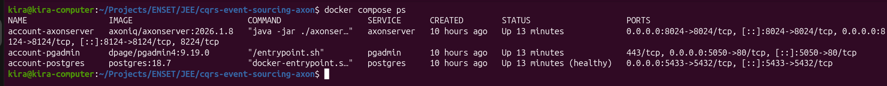

### API (Swagger)
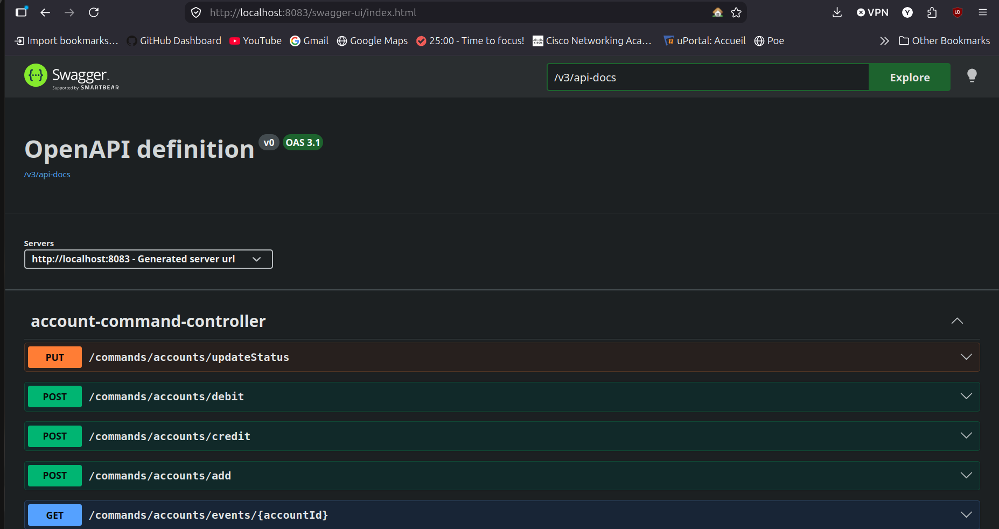

### Côté commande
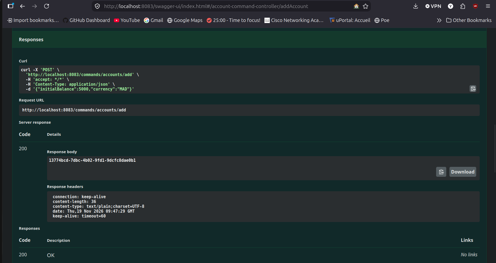

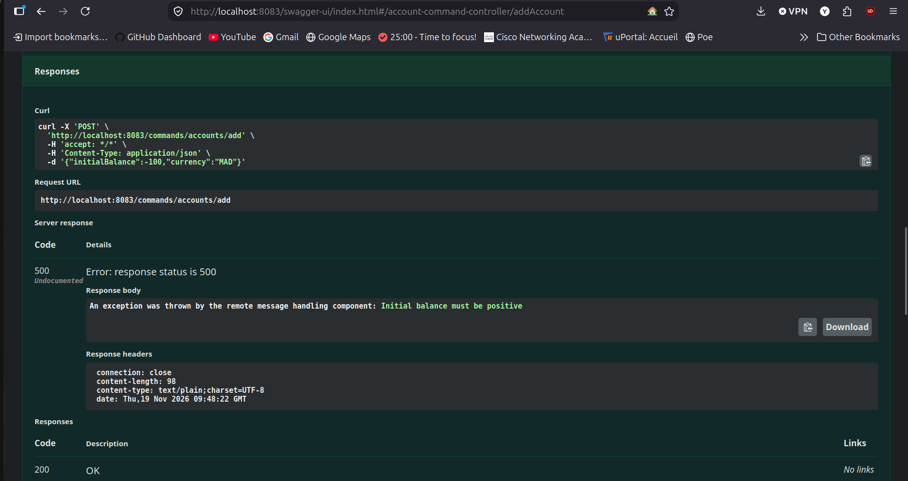

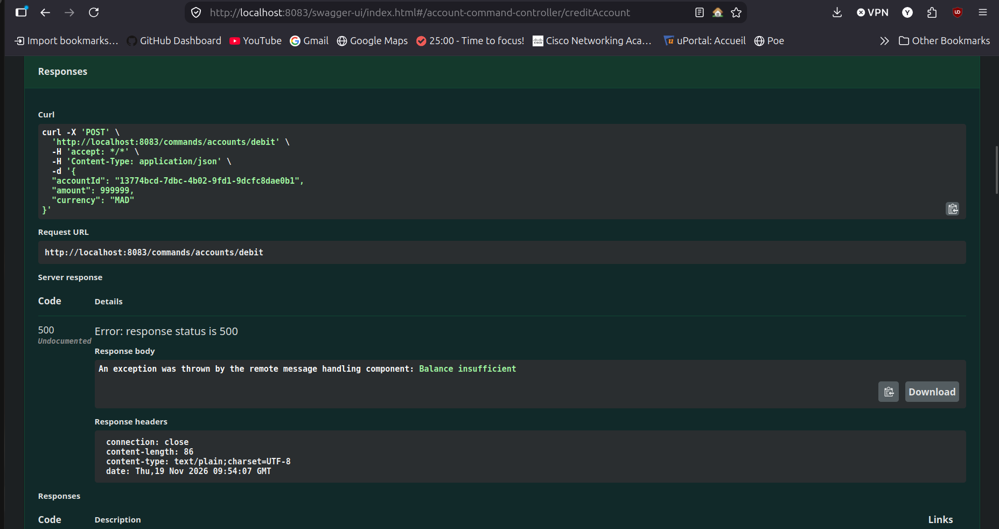

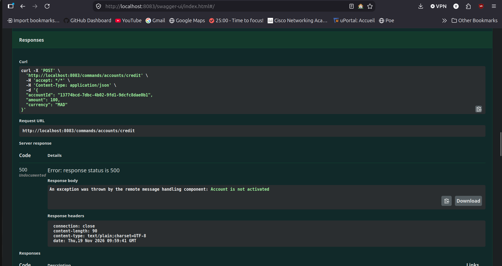

### Event Sourcing : l'historique d'un compte
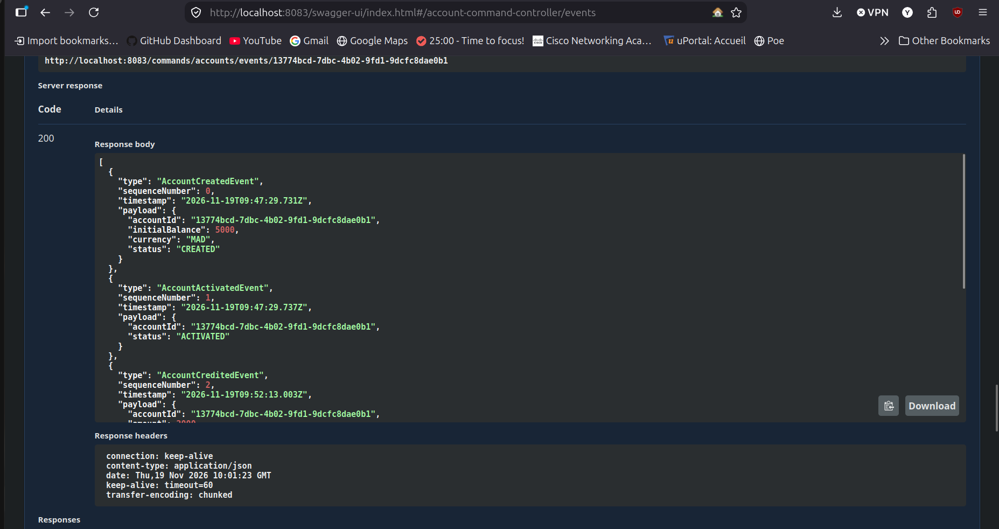

### Côté lecture
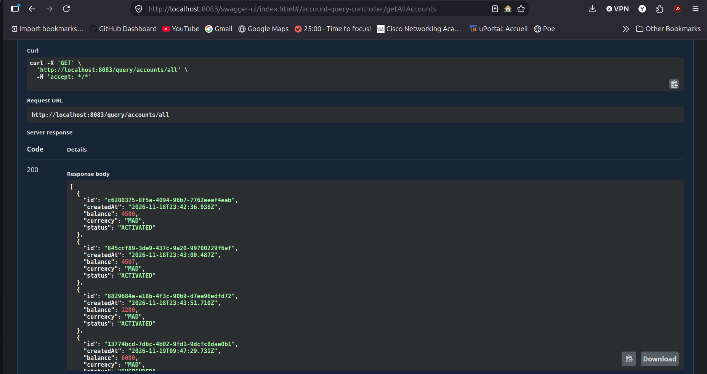

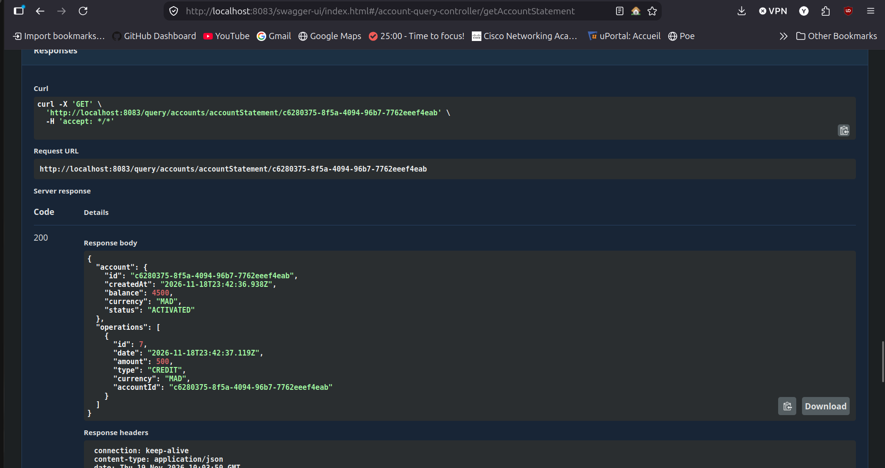

### Temps réel (SSE)
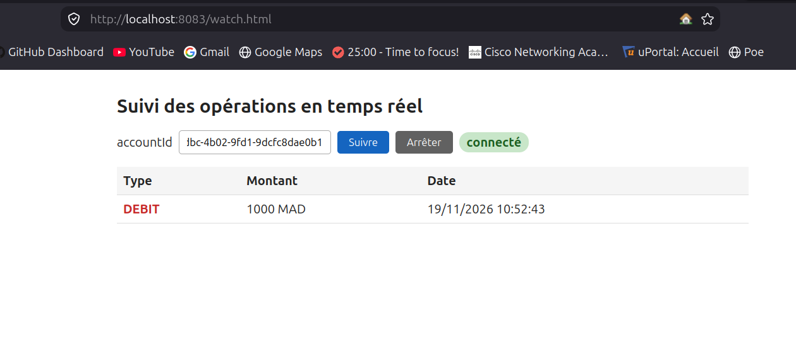

### PostgreSQL (pgAdmin)
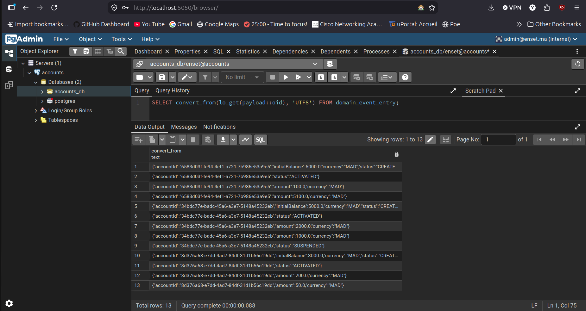

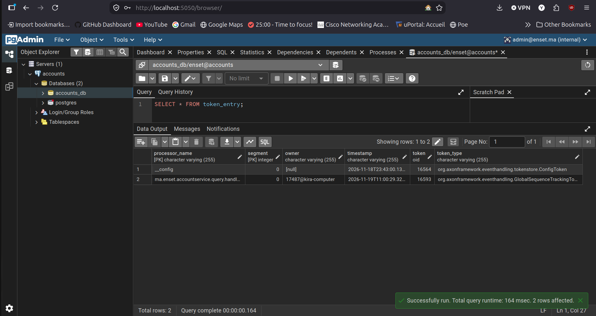

### Axon Server
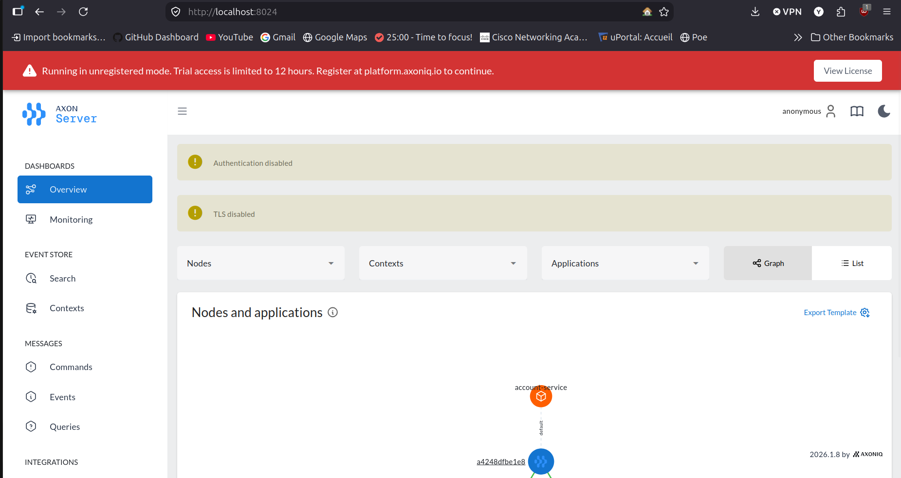

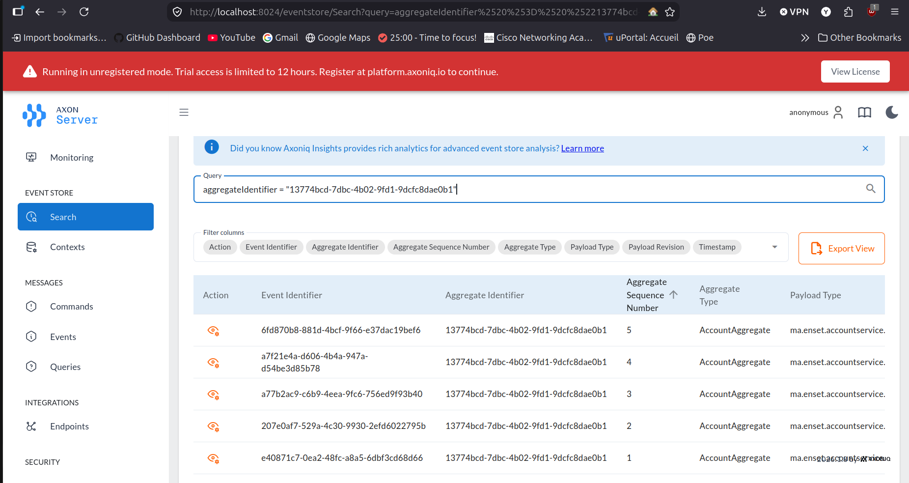

### Tests
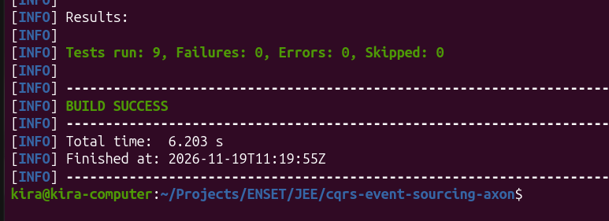